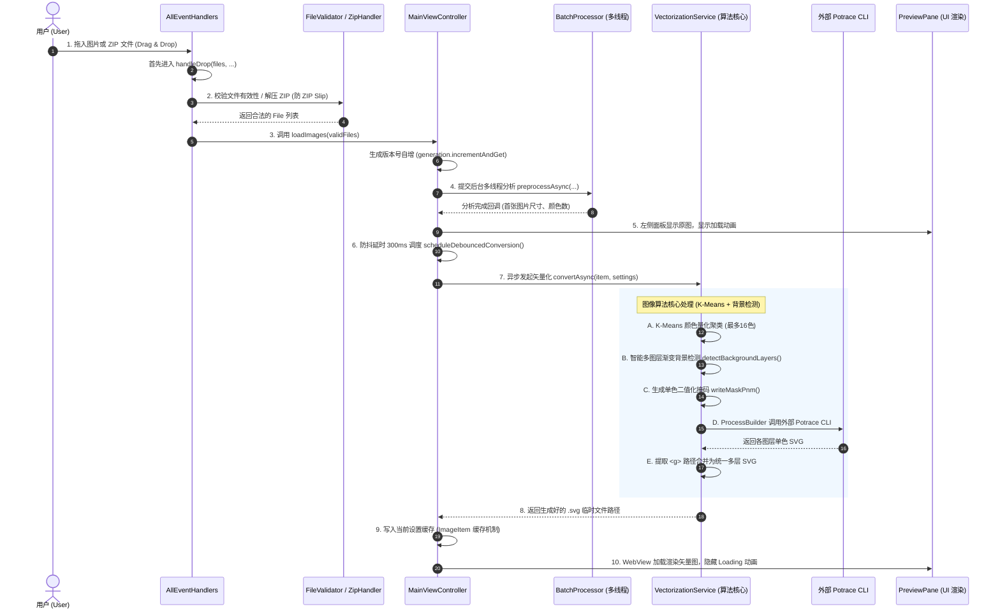

# 图像处理全流程与代码调用链路解析 (Image Processing Pipeline)

本文档详细梳理了当用户将一张图片拖拽进软件窗口后，**程序首先进入哪个方法，整个处理流程依次经过了哪些类、方法和代码，以及各自负责的核心逻辑**。方便在答辩与 Presentation 时向导师和评委老师进行专业、清晰的代码级讲解。

---

## 一、 全流程宏观时序图 (Pipeline Overview)



---

## 二、 详细代码执行链路逐级剖析 (Step-by-Step Code Walkthrough)

### 阶段 1：拖拽事件捕获与最初入口
* **首先进入的方法**：[`AllEventHandlers.java`](file:///d:/workspace/idea/CMU/Adwance%20program/term%20project%201/src/main/java/se233/vectorizer/controller/AllEventHandlers.java) 中的 `handleDrop()` 方法。
* **具体执行代码**：
  ```java
  // 1. 拖拽悬停检测
  target.setOnDragOver(event -> {
      if (event.getDragboard().hasFiles()) {
          event.acceptTransferModes(TransferMode.COPY);
      }
      event.consume();
  });

  // 2. 鼠标松开，文件落下：程序最先被触发的业务方法
  target.setOnDragDropped(event -> {
      Dragboard dragboard = event.getDragboard();
      if (dragboard.hasFiles()) {
          handleDrop(dragboard.getFiles(), stage, controller, view);
          event.setDropCompleted(true);
      }
      event.consume();
  });
  ```
* **解释要点**：
  * JavaFX 通过 `Dragboard` 获取操作系统传递的文件句柄列表。

---

### 阶段 2：文件类型识别与安全校验 (Validation & Unpacking)
* **涉及类**：[`AllEventHandlers.java`](file:///d:/workspace/idea/CMU/Adwance%20program/term%20project%201/src/main/java/se233/vectorizer/controller/AllEventHandlers.java), [`FileValidator.java`](file:///d:/workspace/idea/CMU/Adwance%20program/term%20project%201/src/main/java/se233/vectorizer/util/FileValidator.java), [`ZipHandler.java`](file:///d:/workspace/idea/CMU/Adwance%20program/term%20project%201/src/main/java/se233/vectorizer/util/ZipHandler.java)
* **执行逻辑**：
  1. `handleDrop` 首先调用 `FileValidator.containsZip(rawFiles)` 判断是否为压缩包。
  2. 若包含 `.zip`：调用 `ZipHandler.extractImages(zipFile, tempDir)` 解压内部的图片。此处具备 **ZIP Slip 路径穿越攻击防御**（校验解压目标路径必须以临时目录开头，防止越界覆盖系统关键文件）。
  3. 若为普通图片：调用 `FileValidator.filterValidImages(rawFiles)`，过滤出支持的扩展名（`.png`, `.jpg`, `.jpeg`, `.bmp`, `.pnm`），并验证文件真实可读且长宽大于 0。
  4. 校验通过后，调用控制器的入口：`controller.loadImages(validFiles)`。

---

### 阶段 3：控制器状态重置与并发预处理 (Controller & Multithreading)
* **涉及类**：[`MainViewController.java`](file:///d:/workspace/idea/CMU/Adwance%20program/term%20project%201/src/main/java/se233/vectorizer/controller/MainViewController.java), [`BatchProcessor.java`](file:///d:/workspace/idea/CMU/Adwance%20program/term%20project%201/src/main/java/se233/vectorizer/controller/BatchProcessor.java)
* **执行方法**：`controller.loadImages(List<File> files)`
* **核心代码逻辑**：
  1. **防抖重置与多线程竞态防御**：
     * 调用 `cancelDebounce()` 取消当前正在倒计时的任务。
     * 调用 `generation.incrementAndGet()`：使用原子类 `AtomicLong` 递增生成代数。任何过期的旧后台任务在回调时由于代数不匹配会被自动丢弃，杜绝多线程数据冲突。
  2. **数据模型封装**：将每个 `File` 包装为独立的 `ImageItem` 模型对象，加入 `List<ImageItem>`。
  3. **并发预处理 (`batchProcessor.preprocessAsync`)**：
     * 使用 `ExecutorService` 线程池（按照当前机器 CPU 核心数自动调配并行工作线程）。
     * 每个图片包装为一个 `PreprocessSingleTask` 任务（实现 `Callable<PreprocessedItem>`）：在后台读取宽高，并通过 `ColorAnalyzer.countDistinctColors` 进行像素采样快速分析颜色数。
     * 配合 `ExecutorCompletionService` 实现“完成一张通知一张”，通过 `Platform.runLater()` 平滑更新进度条。
  4. 完成后，调用 `showItem(0)` 展示第一张图片。

---

### 阶段 4：界面就绪与防抖延时调度 (Debounce & UI Setup)
* **涉及类**：[`MainViewController.java`](file:///d:/workspace/idea/CMU/Adwance%20program/term%20project%201/src/main/java/se233/vectorizer/controller/MainViewController.java), [`PreviewPane.java`](file:///d:/workspace/idea/CMU/Adwance%20program/term%20project%201/src/main/java/se233/vectorizer/view/PreviewPane.java)
* **执行方法**：`showItem(int index)` -> `scheduleDebouncedConversion()`
* **核心代码逻辑**：
  1. `previewPane.displayOriginal(image)`：立即在左侧面板加载并显示原始图片位图。
  2. **缓存命中检测 (Cache Hit)**：
     * 调用 `currentItem.getCachedSvg(currentSettings)`。如果该图片在当前相同的转换参数下之前已经计算过，**直接从缓存取用并渲染，无需重新运算**！
  3. **未命中缓存时**：
     * `previewPane.showLoading()`：右侧调出无百分比的轻量旋转 Loading 动画。
     * `scheduleDebouncedConversion()`：使用 `ScheduledExecutorService` 启动一个 **300 毫秒的延时倒计时**。
     * **防抖原理**：用户可能连续拖入多张图或快速滑动颜色滑块，只有在用户停止操作 300ms 后才真正向后台提交耗时计算，极大节约系统资源。

---

### 阶段 5：矢量化核心算法管道 (Vectorization Algorithm Core)
* **涉及类**：[`VectorizationService.java`](file:///d:/workspace/idea/CMU/Adwance%20program/term%20project%201/src/main/java/se233/vectorizer/model/VectorizationService.java)
* **执行方法**：`convertAsync(item, settings)` -> `convert(...)` -> `convertColorLayers(...)`

整个矢量化计算在后台守护线程运行，依次经历 5 个精密子步骤：

#### 步骤 A：K-Means 颜色量化 (`quantize`)
* 位图拥有成千上万种颜色，无法直接用于矢量描摹。
* 算法以均匀网格对图像像素进行抽样（上限限制在 100,000 像素以保障秒级性能）。
* 执行 **K-Means 聚类迭代（8 次循环）**，通过计算 RGB 欧氏空间距离将整张图片所有像素点分配到 $K$ 种最具代表性的主色调调色板中。

#### 步骤 B：智能多图层渐变背景检测 (`detectBackgroundLayers`)
若用户勾选了 `Remove background`：
1. **边框四角采样 (`countEdgeAndCornerPixels`)**：统计全图上下左右 4 条外边框与 4 个顶角像素，计算每个颜色层的外边缘占据率（Edge Ratio）与角点数（Corner Count）。
2. **主背景种子确定 (`findInitialBackgroundSeeds`)**：将边缘占比 $\ge 20\%$ 的绝对主导图层作为基准背景种子。
3. **色彩空间渐变扩展 (`expandGradientBackgroundLayers`)**：
   * 采用迭代传播算法（Propagation），针对同样触及外边缘的相邻色阶，计算其与背景种子之间的 RGB 欧式几何色彩距离：
     $$\Delta C = \sqrt{\Delta R^2 + \Delta G^2 + \Delta B^2}$$
   * 若距离在渐变过渡容差范围内（$\le 95 \sim 125$），判定为同一种天空或环境渐变底色，自动并入待移除背景集合，完美解决深浅渐变天空扣不干净的问题。
4. **前景安全兜底**：总背景移除上限不得超过全图的 $88\%$，强制保留中心主体，杜绝输出空白文件。

#### 步骤 C：生成单色二值化掩码文件 (`writeMaskPnm`)
* 针对每一个需要保留的非背景图层，将其单独提取为一个二值化黑白掩码（当前层颜色像素置为 0 黑色，其余像素置为 255 白色）。
* 将其按标准二进制格式写入临时磁盘文件 `layer-X.ppm`（P6 二进制 PPM 格式）。

#### 步骤 D：调用外部 Potrace CLI 进行单色描边 (`runPotrace`)
* 使用 Java 原生 `ProcessBuilder` 启动外部进程：
  ```bash
  potrace -s -o layer-X.svg -t <turdSize> -C <#HEXColor> layer-X.ppm
  ```
* **Detail 参数的映射控制**：
  * Low -> `-t 10`（过滤微噪点，保留最细微边缘与文字）
  * Medium -> `-t 50`（默认平衡档位）
  * High -> `-t 100`（强力滤波，平滑轮廓，消除噪点）
* 通过 `process.waitFor()` 严密监控进程退出状态码。

#### 步骤 E：提取路径与多层合并 (`mergeSvgLayers`)
* 读取各个单层导出的 `layer-X.svg` 文件。
* 解析并提取出每个文件内部的 `<g>...</g>` 路径矢量节点，将占位黑色替换为该图层真实的 RGB 十六进制颜色代码。
* 按图层层叠顺序组装写入最终生成的统一 `.svg` 文件中。

---

### 阶段 6：界面渲染与缓存呈现 (UI Display & Cache)
* **涉及类**：[`MainViewController.java`](file:///d:/workspace/idea/CMU/Adwance%20program/term%20project%201/src/main/java/se233/vectorizer/controller/MainViewController.java), [`PreviewPane.java`](file:///d:/workspace/idea/CMU/Adwance%20program/term%20project%201/src/main/java/se233/vectorizer/view/PreviewPane.java)
* **执行逻辑**：
  1. `VectorizationService` 的 `CompletableFuture` 完成回调。
  2. `MainViewController` 调用 `Platform.runLater()` 回到 **JavaFX Application Thread**。
  3. 将生成的 SVG 文件路径存入当前图片的设置缓存：`currentItem.putCachedSvg(currentSettings, svgPath)`。
  4. `previewPane.hideLoading()`：关闭转圈 Loading 动画。
  5. `previewPane.displaySvg(svgPath)`：
     * 利用 JavaFX 内置的 WebKit 引擎（`WebView` / `WebEngine`）直接无损矢量渲染该 `.svg` 文件。
     * 底层铺设有 `WritableImage` 与 `PixelWriter` 绘制的程序化黑白相间棋盘格透明背景图案，让抠图镂空效果清晰可见。

---

## 三、 答辩/面试老师常问问题速查表 (Q&A Guide)

| 老师提问方向 | 建议回答核心话术 |
| :--- | :--- |
| **Q1: 为什么拖入多张大图时，界面完全不卡顿？** | “因为我们严格遵守了 **UI 线程隔离**。文件拖入后，只在 UI 线程做轻量级状态更新；所有的图片读取、K-Means 颜色聚类、Potrace 进程调用全部交由 `BatchProcessor` 的 `ExecutorService` 守护线程池在后台并发执行，完成计算后再通过 `Platform.runLater()` 回传 UI 刷新。” |
| **Q2: 如果用户快速拖动滑动条调节参数，会不会触发成百上千次无效运算导致程序崩溃？** | “不会。我们在 `MainViewController` 中设计了 **300ms 的防抖机制 (Debounce)**。通过 `ScheduledExecutorService`，用户每次改动都会重置延时计时器，只有在用户手停下 300 毫秒后，才会真正向后台派发一次最新的矢量化计算。” |
| **Q3: 为什么你以前的背景去除遇到渐变天空删不干净，现在能删干净了？** | “传统算法只找出现次数最多的一层颜色，而渐变天空在量化后会被拆成 2~3 个深浅不同的色阶图层。我们优化为了**多图层渐变边界检测算法**：以图片四周边缘和四角作为种子，结合 **RGB 空间欧氏色差距离（Euclidean Distance）进行空间连续性传播扩展**，将属于同一个连续天空色系的所有图层全部识别并安全剔除，同时设置了 $88\%$ 的上限保护前景。” |
| **Q4: 如果用户拖入包含恶意路径的压缩包，系统会受到攻击吗？** | “不会。我们在 `ZipHandler` 中实现了针对 **ZIP Slip 路径穿越漏洞（Path Traversal）的强制安全防护**，在写入磁盘前严格校验解压目标路径的前缀必须位于临时安全目录内，如果发现诸如 `../../` 等非法字符，会直接抛出安全异常并阻断解压。” |
