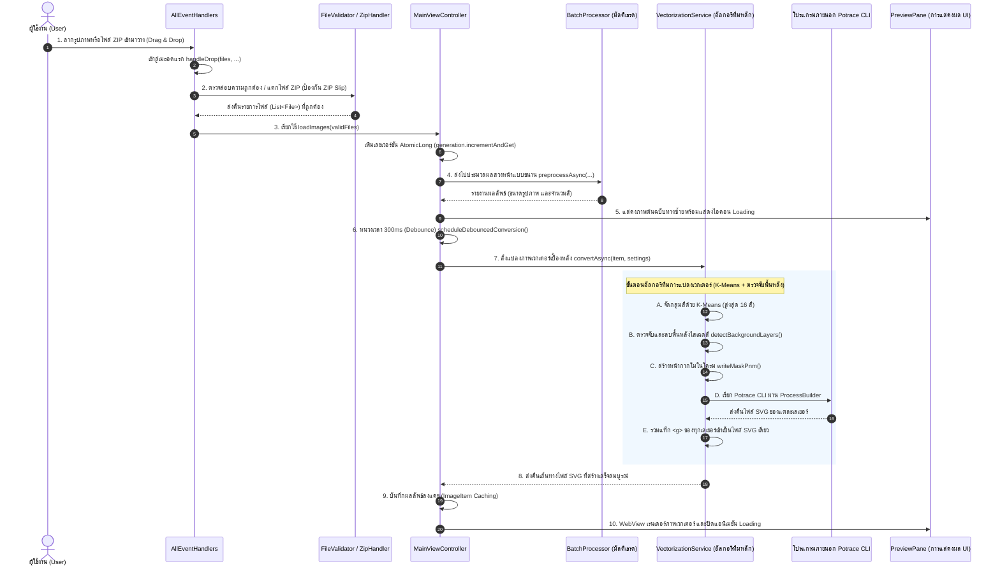

# เอกสารอธิบายขั้นตอนการประมวลผลรูปภาพและลำดับการเรียกโค้ด (Image Processing Pipeline)

เอกสารฉบับนี้จัดทำขึ้นเพื่ออธิบายขั้นตอนการทำงานอย่างละเอียด ตั้งแต่วินาทีที่ผู้ใช้ **ลากไฟล์รูปภาพเข้ามาวางในโปรแกรม (Drag & Drop)** ว่าระบบจะเข้าสู่เมธอดใดเป็นอันดับแรก โค้ดแต่ละส่วนทำงานร่วมกันอย่างไร คลาสและเมธอดใดที่ถูกเรียกใช้ตามลำดับ เพื่อให้ง่ายต่อการนำไปใช้นำเสนอ (Presentation) และตอบคำถามอาจารย์

---

## 1. แผนภาพลำดับการทำงานภาพรวม (Pipeline Sequence Diagram)



---

## 2. ลำดับขั้นตอนการทำงานของโค้ดอย่างละเอียด (Step-by-Step Code Walkthrough)

### ขั้นตอนที่ 1: การดักจับเหตุการณ์ลากวางและจุดเข้าแรกสุด (Drag & Drop Entry Point)
* **เมธอดแรกสุดที่โปรแกรมเริ่มทำงาน**: เมธอด `handleDrop()` ในคลาส [`AllEventHandlers.java`](file:///d:/workspace/idea/CMU/Adwance%20program/term%20project%201/src/main/java/se233/vectorizer/controller/AllEventHandlers.java)
* **โค้ดที่ทำงาน**:
  ```java
  // 1. ตรวจสอบขณะที่ผู้ใช้ลากไฟล์มาวางเหนือหน้าต่างโปรแกรม
  target.setOnDragOver(event -> {
      if (event.getDragboard().hasFiles()) {
          event.acceptTransferModes(TransferMode.COPY);
      }
      event.consume();
  });

  // 2. เมื่อผู้ใช้ปล่อยเมาส์: เมธอดแรกสุดที่จะถูกเรียกทำงาน
  target.setOnDragDropped(event -> {
      Dragboard dragboard = event.getDragboard();
      if (dragboard.hasFiles()) {
          handleDrop(dragboard.getFiles(), stage, controller, view);
          event.setDropCompleted(true);
      }
      event.consume();
  });
  ```
* **คำอธิบาย**: JavaFX จะรับรายการไฟล์จากระบบปฏิบัติการผ่าน `Dragboard` และส่งต่อไปยังเมธอด `handleDrop()`

---

### ขั้นตอนที่ 2: การตรวจสอบไฟล์และความปลอดภัย (File Validation & ZIP Slip Defense)
* **คลาสที่เกี่ยวข้อง**: [`AllEventHandlers.java`](file:///d:/workspace/idea/CMU/Adwance%20program/term%20project%201/src/main/java/se233/vectorizer/controller/AllEventHandlers.java), [`FileValidator.java`](file:///d:/workspace/idea/CMU/Adwance%20program/term%20project%201/src/main/java/se233/vectorizer/util/FileValidator.java), [`ZipHandler.java`](file:///d:/workspace/idea/CMU/Adwance%20program/term%20project%201/src/main/java/se233/vectorizer/util/ZipHandler.java)
* **ลำดับการทำงาน**:
  1. `handleDrop` จะเรียก `FileValidator.containsZip(rawFiles)` เพื่อตรวจสอบว่ามีไฟล์ `.zip` หรือไม่
  2. หากเป็นไฟล์ `.zip`: โปรแกรมจะเรียก `ZipHandler.extractImages(zipFile, tempDir)` เพื่อแตกไฟล์รูปภาพภายใน โดยมีระบบ **ป้องกันการโจมตีแบบ ZIP Slip** (ตรวจสอบว่าพาธปลายทางต้องขึ้นต้นด้วยโฟลเดอร์ชั่วคราว ป้องกันการใช้พาธ `../../` เพื่อเขียนทับไฟล์ระบบสำคัญ)
  3. หากเป็นไฟล์ภาพทั่วไป: โปรแกรมจะเรียก `FileValidator.filterValidImages(rawFiles)` เพื่อคัดกรองเฉพาะนามสกุลที่รองรับ (`.png`, `.jpg`, `.jpeg`, `.bmp`, `.pnm`) และตรวจสอบว่าไฟล์สามารถอ่านได้จริง มีขนาดความกว้างและความสูงมากกว่า 0
  4. เมื่อตรวจสอบผ่านแล้ว จะส่งรายการไฟล์ไปยัง Controller ผ่านคำสั่ง: `controller.loadImages(validFiles)`

---

### ขั้นตอนที่ 3: การรีเซ็ตสถานะและการประมวลผลแบบขนาน (Controller & Multithreaded Preprocessing)
* **คลาสที่เกี่ยวข้อง**: [`MainViewController.java`](file:///d:/workspace/idea/CMU/Adwance%20program/term%20project%201/src/main/java/se233/vectorizer/controller/MainViewController.java), [`BatchProcessor.java`](file:///d:/workspace/idea/CMU/Adwance%20program/term%20project%201/src/main/java/se233/vectorizer/controller/BatchProcessor.java)
* **เมธอดหลัก**: `controller.loadImages(List<File> files)`
* **สาระสำคัญของโค้ด**:
  1. **การป้องกัน Race Condition**:
     * เรียกใช้ `cancelDebounce()` เพื่อยกเลิกงานที่กำลังนับถอยหลังอยู่เดิม
     * เรียกใช้ `generation.incrementAndGet()` โดยใช้ `AtomicLong` เพื่อเพิ่มหมายเลขเวอร์ชันของงาน หากมีงานเก่าจากเธรดเบื้องหลังที่เพิ่งเสร็จ ระบบจะตรวจสอบเลขเวอร์ชันและทิ้งผลลัพธ์นั้นทันที ป้องกันข้อมูลตีกัน
  2. **การแปลงข้อมูลเป็นโมเดล**: แปลง `File` แต่ละรายการให้อยู่ในรูปอ็อบเจกต์ `ImageItem`
  3. **การประมวลผลล่วงหน้าแบบขนาน (`batchProcessor.preprocessAsync`)**:
     * ใช้ `ExecutorService` (ThreadPool) ที่ปรับขนาดตามจำนวนแกนประมวลผล (CPU Cores)
     * แต่ละไฟล์ถูกห่อหุ้มเป็น `PreprocessSingleTask` (ทำงานเป็น `Callable<PreprocessedItem>`) เพื่ออ่านขนาดภาพ และวิเคราะห์จำนวนสีด้วย `ColorAnalyzer.countDistinctColors`
     * ใช้ `ExecutorCompletionService` เพื่อให้รูปภาพที่วิเคราะห์เสร็จก่อนสามารถอัปเดตความคืบหน้าบน UI ผ่าน `Platform.runLater()` ได้ทันที
  4. เมื่อรูปแรกพร้อม จะเรียกคำสั่ง `showItem(0)` เพื่อนำภาพแรกขึ้นแสดง

---

### ขั้นตอนที่ 4: การแสดงภาพต้นฉบับและการหน่วงเวลา (Debounce & UI Setup)
* **คลาสที่เกี่ยวข้อง**: [`MainViewController.java`](file:///d:/workspace/idea/CMU/Adwance%20program/term%20project%201/src/main/java/se233/vectorizer/controller/MainViewController.java), [`PreviewPane.java`](file:///d:/workspace/idea/CMU/Adwance%20program/term%20project%201/src/main/java/se233/vectorizer/view/PreviewPane.java)
* **เมธอดหลัก**: `showItem(int index)` -> `scheduleDebouncedConversion()`
* **ลำดับการทำงาน**:
  1. `previewPane.displayOriginal(image)`: โหลดและแสดงภาพต้นฉบับทางฝั่งซ้ายของหน้าจอทันที
  2. **ระบบตรวจสอบแคช (Cache Hit)**:
     * เรียกคำสั่ง `currentItem.getCachedSvg(currentSettings)` หากภาพนี้ภายใต้การตั้งค่าเดิมเคยถูกแปลงแล้ว ระบบจะดึงผลลัพธ์เวกเตอร์มาแสดงทันทีโดย **ไม่ต้องคำนวณซ้ำ**
  3. **กรณีที่ไม่มีในแคช (Cache Miss)**:
     * `previewPane.showLoading()`: เปิดไอคอนวงล้อหมุนแสดงสถานะกำลังโหลด
     * `scheduleDebouncedConversion()`: ใช้ `ScheduledExecutorService` หน่วงเวลาไว้ **300 มิลลิวินาที (Debounce)**
     * **หลักการของ Debounce**: เพื่อป้องกันกรณีที่ผู้ใช้เลื่อนสไลเดอร์ปรับค่าสีไปมาอย่างรวดเร็ว ระบบจะรอให้ผู้ใช้หยุดเลื่อนเป็นเวลา 300ms ก่อน จึงจะส่งงานไปแปลงภาพจริง ช่วยประหยัดทรัพยากรเครื่องอย่างมาก

---

### ขั้นตอนที่ 5: อัลกอริทึมแกนหลักของการแปลงเวกเตอร์ (Vectorization Core Pipeline)
* **คลาสที่เกี่ยวข้อง**: [`VectorizationService.java`](file:///d:/workspace/idea/CMU/Adwance%20program/term%20project%201/src/main/java/se233/vectorizer/model/VectorizationService.java)
* **เมธอดหลัก**: `convertAsync(item, settings)` -> `convert(...)` -> `convertColorLayers(...)`

งานประมวลผลจะทำงานบน Worker Thread เบื้องหลัง โดยแบ่งออกเป็น 5 ขั้นตอนสำคัญ:

#### ขั้นตอน A: การจัดกลุ่มสีด้วย K-Means (`quantize`)
* เนื่องจากภาพบิตแมปมีเฉดสีนับหมื่นสี จึงไม่สามารถแปลงเส้นรอบรูปได้โดยตรง
* ระบบสุ่มตัวอย่างพิกเซลทั่วภาพ (จำกัดไม่เกิน 100,000 พิกเซลเพื่อความรวดเร็ว)
* รันอัลกอริทึม **K-Means Clustering วนซ้ำ 8 รอบ** โดยคำนวณระยะห่างสีในมิติ RGB เพื่อจัดกลุ่มพิกเซลทั้งหมดของภาพให้เหลือเพียง $K$ สีหลักที่เป็นตัวแทนของภาพ

#### ขั้นตอน B: การตรวจจับและลบพื้นหลังไล่เฉดสี (`detectBackgroundLayers`)
หากผู้ใช้เลือกตัวเลือก `Remove background`:
1. **การเก็บสถิติขอบภาพ (`countEdgeAndCornerPixels`)**: สุ่มนับพิกเซลบนเส้นขอบทั้ง 4 ด้าน และมุมทั้ง 4 ของภาพ เพื่อคำนวณอัตราส่วนการครอบครองขอบภาพ (Edge Ratio) และจำนวนมุม (Corner Count)
2. **การระบุสีพื้นหลังตั้งต้น (`findInitialBackgroundSeeds`)**: สีที่ครองสัดส่วนขอบภาพ $\ge 20\%$ จะถูกกำหนดให้เป็นสีพื้นหลังตั้งต้น
3. **การขยายขอบเขตการไล่เฉดสี (`expandGradientBackgroundLayers`)**:
   * ใช้วิธีการกระจายตัว (Propagation) สำหรับเลเยอร์สีอื่นๆ ที่ติดขอบภาพ โดยคำนวณระยะห่างของสีในมิติ RGB (Euclidean Distance):
     $$\Delta C = \sqrt{\Delta R^2 + \Delta G^2 + \Delta B^2}$$
   * หากระยะห่างสีอยู่ในเกณฑ์การไล่เฉดสี ($\le 95 \sim 125$) แสดงว่าเป็นเฉดสีท้องฟ้าหรือพื้นหลังผืนเดียวกัน และจะถูกตัดออกไปด้วย แก้ปัญหาภาพท้องฟ้าไล่เฉดสีที่ตัดพื้นหลังไม่หมดได้อย่างสมบูรณ์
4. **ระบบความปลอดภัยของภาพ**: จำกัดไม่ให้ลบสีเกิน $88\%$ ของภาพ เพื่อป้องกันไม่ให้เนื้อหาหลักตรงกลางภาพถูกลบหายไป

#### ขั้นตอน C: การสร้างหน้ากากโมโนโครม (`writeMaskPnm`)
* สำหรับแต่ละเลเยอร์สีที่จะเก็บไว้ ระบบจะสกัดเป็นหน้ากากขาว-ดำ (พิกเซลของสีนี้เป็น 0 สีดำ ส่วนพิกเซลอื่นเป็น 255 สีขาว)
* เขียนลงในไฟล์ไบนารีชั่วคราว `layer-X.ppm` (ฟอร์แมต P6 Binary PPM)

#### ขั้นตอน D: การเรียกใช้โปรแกรมภายนอก Potrace CLI (`runPotrace`)
* รันคำสั่งผ่าน Java `ProcessBuilder`:
  ```bash
  potrace -s -o layer-X.svg -t <turdSize> -C <#HEXColor> layer-X.ppm
  ```
* **ค่า Detail Level ที่ส่งไปควบคุม Potrace**:
  * Low -> `-t 10` (ตัดจุดรบกวนขนาดเล็กมาก รักษาเส้นและตัวอักษรบางๆ)
  * Medium -> `-t 50` (ค่ามาตรฐาน สมดุลระหว่างรายละเอียดและความเรียบเนียน)
  * High -> `-t 100` (ตัดจุดรบกวนขนาดใหญ่ออก ทำให้ขอบภาพเรียบเนียนสไตล์มินิมอล)
* ควบคุมและตรวจสอบผลลัพธ์ผ่าน `process.waitFor()`

#### ขั้นตอน E: การรวมเลเยอร์ SVG (`mergeSvgLayers`)
* อ่านไฟล์ `layer-X.svg` ของแต่ละสีที่ Potrace สร้างขึ้น
* สกัดแท็กเส้นพาธ `<g>...</g>` และแทนที่โค้ดสีดำด้วยรหัสสีจริงแบบ Hex Code
* นำทุกเลเยอร์มาซ้อนทับกันตามลำดับและบันทึกเป็นไฟล์ `.svg` สมบูรณ์ชั่วคราว

---

### ขั้นตอนที่ 6: การเรนเดอร์และการแสดงผลบนหน้าจอ (UI Display & Cache)
* **คลาสที่เกี่ยวข้อง**: [`MainViewController.java`](file:///d:/workspace/idea/CMU/Adwance%20program/term%20project%201/src/main/java/se233/vectorizer/controller/MainViewController.java), [`PreviewPane.java`](file:///d:/workspace/idea/CMU/Adwance%20program/term%20project%201/src/main/java/se233/vectorizer/view/PreviewPane.java)
* **การทำงาน**:
  1. เมื่อ `CompletableFuture` ของการแปลงภาพทำงานเสร็จสิ้น
  2. `MainViewController` จะส่งงานกลับไปยัง **JavaFX Application Thread** ผ่าน `Platform.runLater()`
  3. นำพาธไฟล์ SVG บันทึกเข้าแคชของภาพปัจจุบัน: `currentItem.putCachedSvg(currentSettings, svgPath)`
  4. ปิดไอคอนหมุนโหลด: `previewPane.hideLoading()`
  5. แสดงผลภาพเวกเตอร์: `previewPane.displaySvg(svgPath)` โดยใช้ WebKit Engine (`WebView`) เรนเดอร์ไฟล์ `.svg` อย่างคมชัด และมีพื้นหลังลายตารางหมากรุก (Checkerboard) เพื่อแสดงให้เห็นบริเวณที่โปร่งใสอย่างชัดเจน

---

## 3. คำถามที่อาจารย์มักจะถามในการนำเสนอ (Q&A สำหรับการสอบ/พรีเซนต์)

| ประเด็นคำถามของอาจารย์ | แนวทางการตอบที่แนะนำ |
| :--- | :--- |
| **Q1: ทำไมเวลาผู้ใช้ลากภาพขนาดใหญ่เข้ามาพร้อมกัน หน้าจอ UI ถึงไม่ค้าง?** | “เพราะเราออกแบบระบบโดยแยก **UI Thread กับ Background Worker Thread ออกจากกันอย่างเด็ดขาด** เมื่อผู้ใช้วางไฟล์ UI Thread จะทำหน้าที่เพียงรับชื่อไฟล์ ส่วนงานหนักอย่างการอ่านไฟล์, การทำ K-Means Clustering และการรัน Potrace จะถูกส่งไปประมวลผลบน ThreadPool ของ `BatchProcessor` บนเธรดเบื้องหลัง เมื่อเสร็จแล้วจึงส่งข้อมูลกลับมาอัปเดตหน้าจอผ่าน `Platform.runLater()` ครับ” |
| **Q2: หากผู้ใช้เลื่อนสไลเดอร์ปรับจำนวนสีไปมาอย่างรวดเร็ว จะทำให้โปรแกรมรันงานซ้ำซ้อนจนเครื่องค้างหรือไม่?** | “ไม่ค้างครับ เพราะเราใช้ **กลไก Debounce (หน่วงเวลา 300ms)** ด้วย `ScheduledExecutorService` เมื่อผู้ใช้เลื่อนแถบสี งานเก่าที่กำลังรออยู่จะถูกยกเลิกทันที และเริ่มนับเวลาใหม่ โปรแกรมจะเริ่มแปลงภาพก็ต่อเมื่อผู้ใช้หยุดเลื่อนเป็นเวลา 300 มิลลิวินาทีเท่านั้นครับ” |
| **Q3: ทำไมอัลกอริทึมลบพื้นหลังเดิมถึงลบภาพท้องฟ้าไล่เฉดสีไม่หมด แต่เวอร์ชันนี้ทำได้สมบูรณ์?** | “อัลกอริทึมเดิมเลือกตัดเพียงเฉดสีเดียวที่พบมากที่สุด แต่ท้องฟ้าที่มีการไล่ระดับเฉดสีจะถูก K-Means แยกออกเป็น 2-3 เลเยอร์สี เราจึงพัฒนาเป็น **Multi-layer Gradient Detection** โดยใช้พิกเซลรอบขอบภาพและมุมทั้ง 4 เป็นตัวตั้งต้น แล้วใช้ **ระยะห่างของสีแบบ Euclidean Distance ในระบบ RGB** ตรวจจับสีที่ไล่ระดับต่อเนื่องกันรอบขอบภาพ ทำให้สามารถลบเลเยอร์ท้องฟ้าทั้งหมดออกได้อย่างสะอาดตาครับ” |
| **Q4: ถ้ามีคนส่งไฟล์ ZIP ที่มีโครงสร้างไฟล์มุ่งร้าย (Malicious ZIP) เข้ามา โปรแกรมจะปลอดภัยไหม?** | “ปลอดภัย 100% ครับ เพราะในคลาส `ZipHandler` เราได้เขียนโค้ดป้องกัน **ช่องโหว่ ZIP Slip (Path Traversal Attack)** โดยจะตรวจสอบเส้นทางปลายทางของทุกไฟล์ใน ZIP ว่าต้องอยู่ภายใต้ไดเรกทอรีชั่วคราวที่ปลอดภัยเท่านั้น หากพบพาธผิดปกติ เช่น `../../` ระบบจะตัดการทำงานและส่งแจ้งเตือนข้อผิดพลาดทันทีครับ” |
