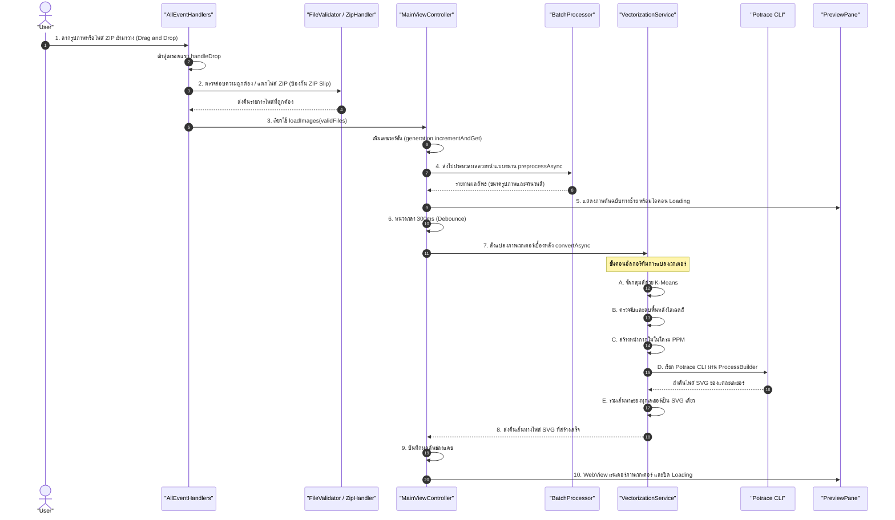

# เอกสารอธิบายขั้นตอนการประมวลผลรูปภาพและลำดับการเรียกโค้ด (Image Processing Pipeline)

เอกสารฉบับนี้จัดทำขึ้นเพื่ออธิบายขั้นตอนการทำงานอย่างละเอียด ตั้งแต่วินาทีที่ผู้ใช้ **ลากไฟล์รูปภาพเข้ามาวางในโปรแกรม (Drag & Drop)** ว่าระบบจะเข้าสู่เมธอดใดเป็นอันดับแรก โค้ดแต่ละส่วนทำงานร่วมกันอย่างไร คลาสและเมธอดใดที่ถูกเรียกใช้ตามลำดับ เพื่อให้ง่ายต่อการนำไปใช้นำเสนอ (Presentation) และตอบคำถามอาจารย์

---

## 1. แผนภาพลำดับการทำงานภาพรวม (Pipeline Sequence Diagram)



---

## 2. ลำดับขั้นตอนการทำงานของโค้ดอย่างละเอียด (Step-by-Step Code Walkthrough)

### ขั้นตอนที่ 1: การดักจับเหตุการณ์ลากวางบนเลเยอร์ UI (View Layer Event Capture)
* **เมื่อผู้ใช้ลากไฟล์มาวาง เมธอดแรกสุดที่จะถูกทริกเกอร์บน UI**:
  * **กรณีที่ยังไม่มีการโหลดภาพ (หน้าจอเริ่มต้น)**: Event Listener `setOnDragDropped` ในบรรทัดที่ 52 ของ [`DropZonePane.java`](file:///d:/workspace/idea/CMU/Adwance%20program/term%20project%201/src/main/java/se233/vectorizer/view/DropZonePane.java#L52-L61):
    ```java
    setOnDragDropped(event -> {
        Dragboard board = event.getDragboard();
        boolean accepted = board.hasFiles();
        if (accepted) {
            filesConsumer.accept(board.getFiles()); // ส่งต่อรายการไฟล์ไปยัง Consumer Callback
        }
        event.setDropCompleted(accepted);
        event.consume();
    });
    ```
  * **กรณีที่อยู่ในหน้าจอแก้ไขรูปภาพแล้ว**: Event Filter ในบรรทัดที่ 73 ของ [`MainView.java`](file:///d:/workspace/idea/CMU/Adwance%20program/term%20project%201/src/main/java/se233/vectorizer/view/MainView.java#L73-L82):
    ```java
    editorPane.addEventFilter(javafx.scene.input.DragEvent.DRAG_DROPPED, event -> {
        Dragboard board = event.getDragboard();
        if (board.hasFiles() && onFilesAccepted != null) {
            onFilesAccepted.accept(board.getFiles());
        }
        event.setDropCompleted(true);
        event.consume();
    });
    ```

---

### ขั้นตอนที่ 2: การเชื่อมต่อ Event สู่ Controller (Wiring to Controller)
* **ตำแหน่งผูกอีเวนต์**: บรรทัดที่ 22 ของ [`AllEventHandlers.java`](file:///d:/workspace/idea/CMU/Adwance%20program/term%20project%201/src/main/java/se233/vectorizer/controller/AllEventHandlers.java#L21-L25):
  ```java
  public static void install(MainViewController controller, MainView view) {
      view.setOnFilesAccepted(files -> controller.loadFiles(files)); // ส่งรายการไฟล์จาก View ตรงสู่ Controller
      installNavigationHandlers(controller, view);
      installActionHandlers(controller, view);
  }
  ```
* **จุดเข้าสู่ฟังก์ชันการทำงานจริงใน Controller (Controller Entry Point)**:
  👉 เมธอด **`public void loadFiles(List<File> files)`** ในบรรทัดที่ 93 ของ [`MainViewController.java`](file:///d:/workspace/idea/CMU/Adwance%20program/term%20project%201/src/main/java/se233/vectorizer/controller/MainViewController.java#L93-L131)

---

### ขั้นตอนที่ 3: การคัดกรองไฟล์, แตกไฟล์ ZIP และการประมวลผลแบบขนาน (Validation & Preprocessing)
* **คลาสที่เกี่ยวข้อง**: [`MainViewController.java`](file:///d:/workspace/idea/CMU/Adwance%20program/term%20project%201/src/main/java/se233/vectorizer/controller/MainViewController.java), [`FileValidator.java`](file:///d:/workspace/idea/CMU/Adwance%20program/term%20project%201/src/main/java/se233/vectorizer/util/FileValidator.java), [`ZipHandler.java`](file:///d:/workspace/idea/CMU/Adwance%20program/term%20project%201/src/main/java/se233/vectorizer/util/ZipHandler.java), [`BatchProcessor.java`](file:///d:/workspace/idea/CMU/Adwance%20program/term%20project%201/src/main/java/se233/vectorizer/controller/BatchProcessor.java)
* **ลำดับขั้นตอนการทำงาน**:
  1. ในเมธอด `loadFiles` บรรทัดที่ 97 จะเรียกเมธอดส่วนตัว `resolveImageFiles(files)` (บรรทัดที่ 484):
     * หากเป็นไฟล์ `.zip`: เรียก `ZipHandler.extractImages(files.get(0))` แตกไฟล์ภาพ พร้อมระบบ **ป้องกันช่องโหว่ ZIP Slip** (ตรวจสอบพาธว่าต้องอยู่ใต้โฟลเดอร์ชั่วคราว ป้องกันการใช้ `../../` เขียนทับไฟล์ระบบ)
     * หากเป็นไฟล์ภาพทั่วไป: เรียก `FileValidator.isSupportedImage(file)` อนุญาตเฉพาะภาพ `.jpg / .png` ที่อ่านได้จริง
  2. สร้างอ็อบเจกต์ข้อมูล `ImageItem`: `ImageItem item = new ImageItem(file);`
  3. บรรทัดที่ 124~126:
     * `mainView.showEditor()`: สลับหน้าจอจากกล่องลากไฟล์เป็นหน้าจอ Editor หลัก
     * `refreshPreview()`: รีเฟรชแสดงภาพต้นฉบับทางฝั่งซ้าย
     * `startInitialPreprocessing(loadedItems)`: ส่งงานวิเคราะห์เข้าสู่ ThreadPool เบื้องหลัง
  4. **การประมวลผลล่วงหน้าแบบขนาน (`BatchProcessor.preprocessAsync`)**:
     * ใช้ `ExecutorService` ตามจำนวนแกนประมวลผลของ CPU รันการวิเคราะห์ขนาดภาพและนับจำนวนสีด้วย `ColorAnalyzer.countDistinctColors` และอัปเดตความคืบหน้าบน UI ด้วย `Platform.runLater()`

---

### ขั้นตอนที่ 4: การหน่วงเวลา Debounce และการตรวจจับแคช (Debounce Scheduling & Cache Hit)
* **คลาสที่เกี่ยวข้อง**: [`MainViewController.java`](file:///d:/workspace/idea/CMU/Adwance%20program/term%20project%201/src/main/java/se233/vectorizer/controller/MainViewController.java#L275-L335)
* **เมธอดหลัก**: `schedulePreviewConversion()` -> `startPreviewConversion(generation)`
* **หลักการของโค้ด**:
  1. **การนับถอยหลัง Debounce 300ms**:
     * เรียกคำสั่ง `previewScheduler.schedule(..., 300, TimeUnit.MILLISECONDS)`
     * หากผู้ใช้เปลี่ยนค่าหรือสลับภาพก่อนครบ 300ms งานเดิมจะถูกยกเลิกทันที (`pendingPreview.cancel(false)`) ป้องกันการคำนวณซ้ำซ้อน
  2. **ระบบตรวจจับแคช (Cache Hit)**:
     * เมื่อครบ 300ms จะเข้าสู่ `startPreviewConversion` และตรวจสอบ `item.getCachedSvg(settings)` ก่อนเสมอ
     * หากภาพนี้ภายใต้การตั้งค่าเดิมเคยแปลงไว้แล้ว ระบบจะดึงพาธไฟล์ SVG เดิมมาแสดงทันทีโดย **ไม่ต้องแปลงใหม่**
  3. **กรณีที่ไม่มีในแคช**:
     * เปิดไอคอนวงล้อหมุน `mainView.getPreviewPane().setBusy(true)`
     * ส่งงาน `Task<Void>` เข้าสู่ `previewExecutor` เธรดพูลเบื้องหลัง เพื่อสั่งแปลงภาพเวกเตอร์:
       ```java
       Path svg = vectorizationService.convertAsync(item, settings).join();
       item.setVectorizedPath(svg);
       ```

---

### ขั้นตอนที่ 5: อัลกอริทึมแกนหลักของการแปลงเวกเตอร์ (Vectorization Core Pipeline)
* **คลาสที่เกี่ยวข้อง**: [`VectorizationService.java`](file:///d:/workspace/idea/CMU/Adwance%20program/term%20project%201/src/main/java/se233/vectorizer/model/VectorizationService.java)
* **เมธอดหลัก**: `convertAsync(item, settings)` -> `convert(...)` -> `convertColorLayers(...)`

งานประมวลผลจะทำงานบน Worker Thread เบื้องหลัง โดยแบ่งออกเป็น 5 ขั้นตอนสำคัญ:

#### ขั้นตอน A: การจัดกลุ่มสีด้วย K-Means (`quantize`)
* เนื่องจากภาพบิตแมปมีเฉดสีนับหมื่นสี จึงไม่สามารถแปลงเส้นรอบรูปได้โดยตรง
* ระบบสุ่มตัวอย่างพิกเซลทั่วภาพ (จำกัดไม่เกิน 100,000 พิกเซลเพื่อความรวดเร็ว)
* รันอัลกอริทึม **K-Means Clustering วนซ้ำ 8 รอบ** โดยคำนวณระยะห่างสีในมิติ RGB เพื่อจัดกลุ่มพิกเซลทั้งหมดของภาพให้เหลือเพียง $K$ สีหลักที่เป็นตัวแทนของภาพ

#### ขั้นตอน B: การตรวจจับและลบพื้นหลังไล่เฉดสี (`detectBackgroundLayers`)
หากผู้ใช้เลือกตัวเลือก `Remove background`:
1. **การเก็บสถิติขอบภาพ (`countEdgeAndCornerPixels`)**: สุ่มนับพิกเซลบนเส้นขอบทั้ง 4 ด้าน และมุมทั้ง 4 ของภาพ เพื่อคำนวณอัตราส่วนการครอบครองขอบภาพ (Edge Ratio) และจำนวนมุม (Corner Count)
2. **การระบุสีพื้นหลังตั้งต้น (`findInitialBackgroundSeeds`)**: สีที่ครองสัดส่วนขอบภาพ $\ge 20\%$ จะถูกกำหนดให้เป็นสีพื้นหลังตั้งต้น
3. **การขยายขอบเขตการไล่เฉดสี (`expandGradientBackgroundLayers`)**:
   * ใช้วิธีการกระจายตัว (Propagation) สำหรับเลเยอร์สีอื่นๆ ที่ติดขอบภาพ โดยคำนวณระยะห่างของสีในมิติ RGB (Euclidean Distance):
     $$\Delta C = \sqrt{\Delta R^2 + \Delta G^2 + \Delta B^2}$$
   * หากระยะห่างสีอยู่ในเกณฑ์การไล่เฉดสี ($\le 95 \sim 125$) แสดงว่าเป็นเฉดสีท้องฟ้าหรือพื้นหลังผืนเดียวกัน และจะถูกตัดออกไปด้วย แก้ปัญหาภาพท้องฟ้าไล่เฉดสีที่ตัดพื้นหลังไม่หมดได้อย่างสมบูรณ์
4. **ระบบความปลอดภัยของภาพ**: จำกัดไม่ให้ลบสีเกิน $88\%$ ของภาพ เพื่อป้องกันไม่ให้เนื้อหาหลักตรงกลางภาพถูกลบหายไป

#### ขั้นตอน C: การสร้างหน้ากากโมโนโครม (`writeMaskPnm`)
* สำหรับแต่ละเลเยอร์สีที่จะเก็บไว้ ระบบจะสกัดเป็นหน้ากากขาว-ดำ (พิกเซลของสีนี้เป็น 0 สีดำ ส่วนพิกเซลอื่นเป็น 255 สีขาว)
* เขียนลงในไฟล์ไบนารีชั่วคราว `layer-X.ppm` (ฟอร์แมต P6 Binary PPM)

#### ขั้นตอน D: การเรียกใช้โปรแกรมภายนอก Potrace CLI (`runPotrace`)
* รันคำสั่งผ่าน Java `ProcessBuilder`:
  ```bash
  potrace -s -o layer-X.svg -t <turdSize> -C <#HEXColor> layer-X.ppm
  ```
* **ค่า Detail Level ที่ส่งไปควบคุม Potrace**:
  * Low -> `-t 10` (ตัดจุดรบกวนขนาดเล็กมาก รักษาเส้นและตัวอักษรบางๆ)
  * Medium -> `-t 50` (ค่ามาตรฐาน สมดุลระหว่างรายละเอียดและความเรียบเนียน)
  * High -> `-t 100` (ตัดจุดรบกวนขนาดใหญ่ออก ทำให้ขอบภาพเรียบเนียนสไตล์มินิมอล)
* ควบคุมและตรวจสอบผลลัพธ์ผ่าน `process.waitFor()`

#### ขั้นตอน E: การรวมเลเยอร์ SVG (`mergeSvgLayers`)
* อ่านไฟล์ `layer-X.svg` ของแต่ละสีที่ Potrace สร้างขึ้น
* สกัดแท็กเส้นพาธ `<g>...</g>` และแทนที่โค้ดสีดำด้วยรหัสสีจริงแบบ Hex Code
* นำทุกเลเยอร์มาซ้อนทับกันตามลำดับและบันทึกเป็นไฟล์ `.svg` สมบูรณ์ชั่วคราว

---

### ขั้นตอนที่ 6: การเรนเดอร์และการแสดงผลบนหน้าจอ (UI Display & Cache)
* **คลาสที่เกี่ยวข้อง**: [`MainViewController.java`](file:///d:/workspace/idea/CMU/Adwance%20program/term%20project%201/src/main/java/se233/vectorizer/controller/MainViewController.java), [`PreviewPane.java`](file:///d:/workspace/idea/CMU/Adwance%20program/term%20project%201/src/main/java/se233/vectorizer/view/PreviewPane.java)
* **การทำงาน**:
  1. เมื่อ `CompletableFuture` ของการแปลงภาพทำงานเสร็จสิ้น
  2. `MainViewController` จะส่งงานกลับไปยัง **JavaFX Application Thread** ผ่าน `Platform.runLater()`
  3. นำพาธไฟล์ SVG บันทึกเข้าแคชของภาพปัจจุบัน: `currentItem.putCachedSvg(currentSettings, svgPath)`
  4. ปิดไอคอนหมุนโหลด: `previewPane.hideLoading()`
  5. แสดงผลภาพเวกเตอร์: `previewPane.displaySvg(svgPath)` โดยใช้ WebKit Engine (`WebView`) เรนเดอร์ไฟล์ `.svg` อย่างคมชัด และมีพื้นหลังลายตารางหมากรุก (Checkerboard) เพื่อแสดงให้เห็นบริเวณที่โปร่งใสอย่างชัดเจน

---

## 3. คำถามที่อาจารย์มักจะถามในการนำเสนอ (Q&A สำหรับการสอบ/พรีเซนต์)

| ประเด็นคำถามของอาจารย์ | แนวทางการตอบที่แนะนำ |
| :--- | :--- |
| **Q1: ทำไมเวลาผู้ใช้ลากภาพขนาดใหญ่เข้ามาพร้อมกัน หน้าจอ UI ถึงไม่ค้าง?** | “เพราะเราออกแบบระบบโดยแยก **UI Thread กับ Background Worker Thread ออกจากกันอย่างเด็ดขาด** เมื่อผู้ใช้วางไฟล์ UI Thread จะทำหน้าที่เพียงรับชื่อไฟล์ ส่วนงานหนักอย่างการอ่านไฟล์, การทำ K-Means Clustering และการรัน Potrace จะถูกส่งไปประมวลผลบน ThreadPool ของ `BatchProcessor` บนเธรดเบื้องหลัง เมื่อเสร็จแล้วจึงส่งข้อมูลกลับมาอัปเดตหน้าจอผ่าน `Platform.runLater()` ครับ” |
| **Q2: หากผู้ใช้เลื่อนสไลเดอร์ปรับจำนวนสีไปมาอย่างรวดเร็ว จะทำให้โปรแกรมรันงานซ้ำซ้อนจนเครื่องค้างหรือไม่?** | “ไม่ค้างครับ เพราะเราใช้ **กลไก Debounce (หน่วงเวลา 300ms)** ด้วย `ScheduledExecutorService` เมื่อผู้ใช้เลื่อนแถบสี งานเก่าที่กำลังรออยู่จะถูกยกเลิกทันที และเริ่มนับเวลาใหม่ โปรแกรมจะเริ่มแปลงภาพก็ต่อเมื่อผู้ใช้หยุดเลื่อนเป็นเวลา 300 มิลลิวินาทีเท่านั้นครับ” |
| **Q3: ทำไมอัลกอริทึมลบพื้นหลังเดิมถึงลบภาพท้องฟ้าไล่เฉดสีไม่หมด แต่เวอร์ชันนี้ทำได้สมบูรณ์?** | “อัลกอริทึมเดิมเลือกตัดเพียงเฉดสีเดียวที่พบมากที่สุด แต่ท้องฟ้าที่มีการไล่ระดับเฉดสีจะถูก K-Means แยกออกเป็น 2-3 เลเยอร์สี เราจึงพัฒนาเป็น **Multi-layer Gradient Detection** โดยใช้พิกเซลรอบขอบภาพและมุมทั้ง 4 เป็นตัวตั้งต้น แล้วใช้ **ระยะห่างของสีแบบ Euclidean Distance ในระบบ RGB** ตรวจจับสีที่ไล่ระดับต่อเนื่องกันรอบขอบภาพ ทำให้สามารถลบเลเยอร์ท้องฟ้าทั้งหมดออกได้อย่างสะอาดตาครับ” |
| **Q4: ถ้ามีคนส่งไฟล์ ZIP ที่มีโครงสร้างไฟล์มุ่งร้าย (Malicious ZIP) เข้ามา โปรแกรมจะปลอดภัยไหม?** | “ปลอดภัย 100% ครับ เพราะในคลาส `ZipHandler` เราได้เขียนโค้ดป้องกัน **ช่องโหว่ ZIP Slip (Path Traversal Attack)** โดยจะตรวจสอบเส้นทางปลายทางของทุกไฟล์ใน ZIP ว่าต้องอยู่ภายใต้ไดเรกทอรีชั่วคราวที่ปลอดภัยเท่านั้น หากพบพาธผิดปกติ เช่น `../../` ระบบจะตัดการทำงานและส่งแจ้งเตือนข้อผิดพลาดทันทีครับ” |
